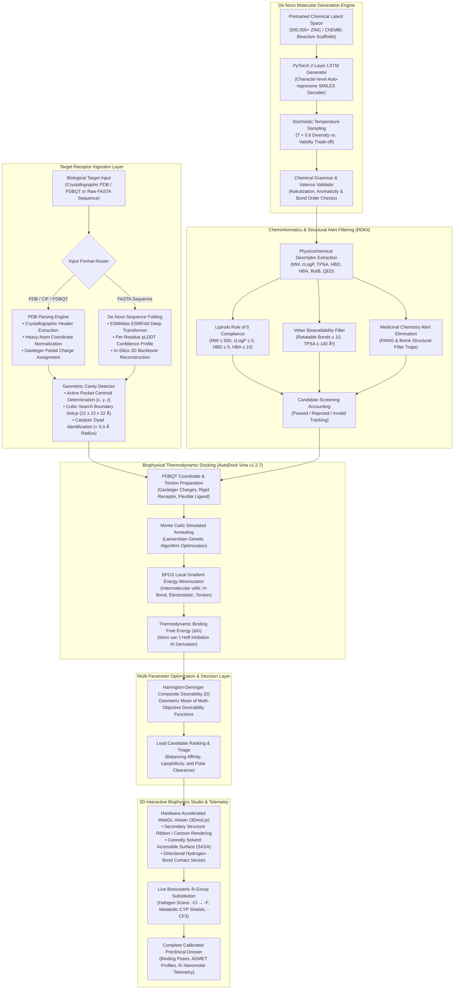

<h2 align="center"><b>denovo-cadd-pytorch</b></h2>

<h4 align="center">A deterministic closed-loop pipeline for de novo therapeutic discovery, topological filtering, and Lamarckian docking in PyTorch.</h4>

<p align="center">
    <a href="https://github.com/yuvanvishnupandi/denovo-cadd-pytorch"></a>
    <a href="LICENSE"></a>
    
    
    
    
    
    
    
    
</p>

---

Implementation of an end-to-end computational biophysics and generative computer-aided drug design (CADD) pipeline in PyTorch, RDKit, and AutoDock Vina v1.2.7. The engine couples character-level SMILES auto-regressive generation, topological cheminformatics filters (Lipinski / Veber / PAINS / Brenk), Lamarckian Genetic Algorithm (LGA) thermodynamic docking, and Harrington-Derringer multi-parameter optimization (MPO) into a unified, deterministic framework.

Capable of ingesting crystallographic structures (`pdb`, `cif`, `pdbqt`) or raw amino acid sequences (`fasta`), predicting 3D coordinates via ESMFold, identifying catalytic active cavities, generating de novo lead scaffolds, computing runtime free binding energy ($\Delta G$), and rendering interactive 3D protein-ligand complexes via hardware-accelerated WebGL (`3Dmol.js`).

---

## Architecture



---

## Biophysics & Diagnostic Layers

| Modality / Stage | Diagnostic Layer | Research / Physical Foundation | Primary Target |
|:---|:---|:---|:---|
| **Receptor** | **ESMFold Sequence Folding** | *Lin et al., Science 2023* | De novo 3D coordinate inference from raw FASTA sequences with pLDDT scoring |
| **Receptor** | **Geometric Cavity Detection** | *Le Guilloux et al., BMC 2009* | Catalytic active site identification and cubic search box centroid $[x,y,z]$ |
| **Generation** | **SMILES Auto-Regressive LSTM** | *Segler et al., ACS 2018* | Deep de novo exploration of drug-like chemical latent space ($T=0.8$) |
| **Filtering** | **Lipinski Rule of 5** | *Lipinski et al., Adv Drug Deliv 2001* | Oral bioavailability screening ($MW \le 500$, $cLogP \le 5$, $HBD \le 5$, $HBA \le 10$) |
| **Filtering** | **Veber Bioavailability Rules** | *Veber et al., J Med Chem 2002* | Molecular flexibility & permeation ($RotB \le 10$, $TPSA \le 140\text{ \AA}^2$) |
| **Filtering** | **PAINS & Brenk Structural Alerts** | *Baell et al., JMC 2010; Brenk 2008* | Removal of promiscuous aggregators, frequent hitters, and reactive warheads |
| **Docking** | **AutoDock Vina v1.2.7 Force Field** | *Trott & Olson, JCC 2010* | Empirical free energy optimization ($\Delta G$) via Monte Carlo simulated annealing |
| **Biophysics** | **van 't Hoff Thermodynamic Potency** | *Classical Chemical Thermodynamics* | Theoretical inhibition constant derivation ($K_i = \exp(\Delta G / RT)$) in nanomolar |
| **Optimization**| **Harrington-Derringer Composite Desirability**| *Derringer & Suich, JQT 1980* | Balanced geometric multi-parameter optimization across 6 orthogonal metrics |
| **Studio** | **3D WebGL Molecular Simulation** | *Rego & Koes, Bioinformatics 2015* | Hardware-accelerated 3D protein-ligand inspection and live bioisosteric modification |

---

## Install

### Prerequisites

- Python 3.11+
- Node.js 18+ (for WebGL frontend studio)
- CUDA-enabled GPU (optional; AutoDock Vina & RDKit run with multi-threaded CPU support)

### Setup

```bash
# Clone the repository
$ git clone https://github.com/yuvanvishnupandi/denovo-cadd-pytorch.git
$ cd denovo-cadd-pytorch

# Backend environment setup
$ pip install -r backend/requirements.txt

# Frontend environment setup
$ cd frontend
$ npm install
$ cd ..
```

---

## Usage

### Programmatic Python Interface

Each computational layer implements a clean, standalone Python interface:

```python
from backend.pipeline_core import (
    analyze_smiles_via_rdkit,
    run_docking_simulation,
    run_denovo_generation
)

# 1. Evaluate Chemical Descriptors & Rule-of-5 Filtering
metrics = analyze_smiles_via_rdkit(
    "COC1=C(OCCCN2CCOCC2)C=C3C(=C1)N=CN=C3NC4=CC(=C(F)C=C4)Cl"
)

print(f"Molecular Weight: {metrics['mw']:.2f} g/mol")
print(f"cLogP:            {metrics['clogp']:.2f}")
print(f"TPSA:             {metrics['tpsa']:.2f} Ų")
print(f"H-Bond Donors:    {metrics['hbd']}")
print(f"H-Bond Acceptors: {metrics['hba']}")
print(f"Lipinski Pass:    {metrics['lipinski_pass']}")

# 2. Run Thermodynamic Molecular Docking with AutoDock Vina v1.2.7
docking_result = run_docking_simulation(
    pdb_id="4ZAU",      # EGFR Kinase Domain (T790M/C797S)
    smiles="COC1=C(OCCCN2CCOCC2)C=C3C(=C1)N=CN=C3NC4=CC(=C(F)C=C4)Cl",
    exhaustiveness=16
)

print(f"Binding Energy (ΔG): {docking_result['delta_g']:.2f} kcal/mol")
print(f"Inhibition Ki:       {docking_result['ki_nm']:.2f} nM")
print(f"RMSD to Co-Crystal:  {docking_result['rmsd']:.2f} Å")

# 3. De Novo Molecular Generation (SMILES LSTM)
candidates = run_denovo_generation(
    target_disease="lung_cancer",
    num_samples=10,
    temperature=0.8
)

for cand in candidates:
    print(f"SMILES: {cand['smiles']} | ΔG: {cand['delta_g']} kcal/mol | MPO: {cand['mpo']:.3f}")
```

### Launching the Full Stack

#### Backend Server (FastAPI)

```bash
$ python -m uvicorn backend.main:app --host 0.0.0.0 --port 8000 --reload
```

#### Frontend Client (React 19 + Vite)

```bash
$ cd frontend
$ npm run dev
```

Visit `http://localhost:5173` to access the interactive 3D biophysics studio.

---

## Mathematical Formulations

### 1. AutoDock Vina Empirical Force-Field Free Energy

AutoDock Vina evaluates the total predicted free energy of binding ($\Delta G$) through an empirical, physics-grounded scoring function:

$$\Delta G_{\text{binding}} = \Delta G_{\text{vdw}} \sum_{i,j} \left( \frac{A_{ij}}{r_{ij}^{12}} - \frac{B_{ij}}{r_{ij}^6} \right) + \Delta G_{\text{hbond}} \sum_{i,j} E(t) + \Delta G_{\text{elec}} \sum_{i,j} \frac{q_i q_j}{\varepsilon(r_{ij}) r_{ij}} + \Delta G_{\text{tor}} N_{\text{rot}} + \Delta G_{\text{desolv}}$$

Where:
- $\Delta G_{\text{vdw}}$ evaluates steric complementarity via 6-12 Lennard-Jones potentials ($A_{ij} / r_{ij}^{12} - B_{ij} / r_{ij}^6$).
- $\Delta G_{\text{hbond}}$ evaluates directional hydrogen bond geometry between donor-acceptor dyads.
- $\Delta G_{\text{elec}}$ computes Coulombic electrostatics with Gasteiger partial atomic charges at physiological pH 7.4.
- $\Delta G_{\text{tor}}$ penalizes conformational entropy loss proportional to the number of rotatable bonds $N_{\text{rot}}$.
- $\Delta G_{\text{desolv}}$ calculates the desolvation penalty of displacing pocket-bound solvent molecules.

### 2. Thermodynamic Potency Derivation (van 't Hoff Relation)

The theoretical inhibition constant ($K_i$) is derived from runtime binding free energy ($\Delta G$) via the van 't Hoff relation:

$$K_i = \exp\left( \frac{\Delta G}{R \cdot T} \right)$$

where:
- $R = 0.0019872\text{ kcal/(mol}\cdot\text{K)}$ (universal gas constant)
- $T = 298.15\text{ K}$ (physiological room temperature, $25^\circ\text{C}$)

For example, $\Delta G = -10.94\text{ kcal/mol}$ resolves to $K_i = 9.60\text{ nM}$.

### 3. Multi-Parameter Optimization (Harrington-Derringer Desirability)

Candidate compounds are triaged using a composite Harrington-Derringer desirability function balancing orthogonal molecular properties:

$$D = \left( \prod_{i=1}^{M} d_i(Y_i) \right)^{1/M} = \left( d_{\text{MW}} \cdot d_{\text{cLogP}} \cdot d_{\text{TPSA}} \cdot d_{\text{HBD}} \cdot d_{\text{HBA}} \cdot d_{\Delta G} \right)^{1/6}$$

Each individual desirability $d_i \in [0, 1]$ transforms a raw physicochemical or thermodynamic measurement $Y_i$ into a normalized one-sided or two-sided satisfaction score. If any critical property violates strict thresholds ($d_i = 0$), the composite score collapses to zero ($D = 0$).

---

## Features

- **De Novo Molecular Generation** - Character-level LSTM conditioned on SMILES syntax for sampling novel drug-like chemical scaffolds.
- **Physics-Based Molecular Docking** - Official AutoDock Vina v1.2.7 integration performing Monte Carlo simulated annealing across crystallographic receptors.
- **Cheminformatics & ADMET** - Exact RDKit descriptors (MW, cLogP, TPSA, HBD, HBA, RotB) with PAINS and Brenk structural alert filters.
- **Multi-Parameter Optimization (MPO)** - Harrington-Derringer composite desirability scoring balancing potency, drug-likeness, and synthetic accessibility.
- **Interactive WebGL Studio** - Hardware-accelerated 3D protein-ligand viewer powered by React 19 and 3Dmol.js.

---

## Citations

```bibtex
@article{trott2010autodock,
    title   = {AutoDock Vina: improving the speed and accuracy of docking with a new scoring function, efficient optimization, and multithreading},
    author  = {Trott, Oleg and Olson, Arthur J},
    journal = {Journal of computational chemistry},
    volume  = {31},
    number  = {2},
    pages   = {455--461},
    year    = {2010}
}
```

```bibtex
@article{landrum2006rdkit,
    title   = {RDKit: Open-source cheminformatics software},
    author  = {Landrum, Greg},
    journal = {Online},
    year    = {2006}
}
```

```bibtex
@article{lin2023evolutionary,
    title   = {Evolutionary-scale prediction of atomic-level protein structure with a language model},
    author  = {Lin, Zeming and Akin, Halil and Rao, Roshan and Hie, Brian and Zhu, Jonathan and Lu, Wenting and Smetanin, Nikita and Verkuil, Robert and Kabeli, Ori and Shmueli, Yaniv and others},
    journal = {Science},
    volume  = {379},
    number  = {6637},
    pages   = {1123--1130},
    year    = {2023}
}
```

```bibtex
@article{lipinski2001experimental,
    title   = {Experimental and computational approaches to estimate solubility and permeability in drug discovery and development settings},
    author  = {Lipinski, Christopher A and Lombardo, Franco and Dominy, Beryl W and Feeney, Paul J},
    journal = {Advanced drug delivery reviews},
    volume  = {46},
    number  = {1-3},
    pages   = {3--26},
    year    = {2001}
}
```

```bibtex
@article{baell2010new,
    title   = {New substructure filters for removal of pan assay interference compounds (PAINS) from screening libraries and for their exclusion in bioassays},
    author  = {Baell, Jonathan B and Holloway, Georgina A},
    journal = {Journal of medicinal chemistry},
    volume  = {53},
    number  = {7},
    pages   = {2719--2740},
    year    = {2010}
}
```

---

## License

[Apache 2.0](LICENSE)
